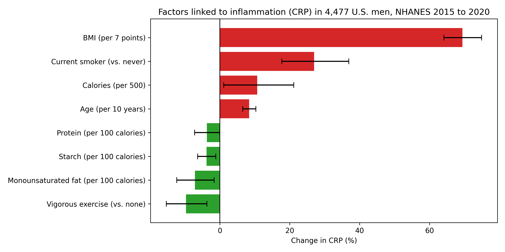
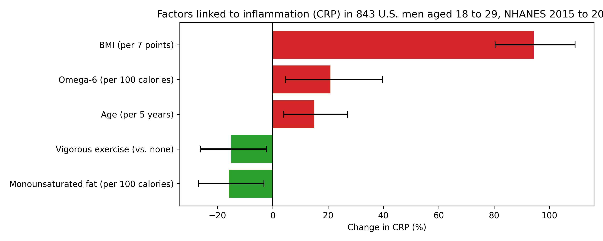

# Diet and Inflammation in Young Men: An NHANES Analysis

A multiple regression analysis concerning how different macronutrients correlate with higher or lower levels of inflammation among adult men. The data comes from the NHANES 2015 to 2016 and 2017 to 2020 survey cycles.

## Overview

Originally, I embarked on this project to answer one question that I thought was quite simple and straightforward: what is the most optimal diet to reduce inflammation in young men? I like to consider myself a dedicated weightlifter, and I have always wondered what would be the best diet for me to eat consistently to support muscle growth. Inflammation gives a lot of information about an individual's health, and having low chronic inflammation on average supports hypertrophy, or in simple terms, muscle growth. It's important to distinguish between temporary and chronic inflammation. Temporary inflammation occurs on a day to day basis, such as when you are sick or right after exercise, while chronic inflammation is the lower, constant level that stays in the background. Controlling the factors I can, such as diet, is critical to improving my muscle growth as much as possible. Before the project, while researching the question, it surprised me that there wasn't a clear consensus on which diet actually achieved this. Some would say it's carnivore, others would say it's eating vegan. Because there was no clear answer to this question, I decided to take matters into my own hands by analyzing CDC health survey data.

## Data

The data came from the CDC's National Health and Nutrition Examination Survey, or NHANES, a national study that collects health data on thousands of Americans every two years through interviews, physical exams, and lab tests. I chose it because it's one of the few sources where the same people have both a blood test for inflammation and a detailed record of what they ate, and it's free, publicly available, and designed to represent the U.S. population. From it, I used eight types of files across the 2015 to 2016 and 2017 to 2020 cycles: blood test results for C-reactive protein (CRP), a protein the liver releases when there's inflammation in the body; two days of diet records; demographics like age and sex; body measurements like BMI; and questionnaires on sleep, physical activity, and smoking.

| File type | 2015 to 2016 | 2017 to 2020 |
| --- | --- | --- |
| CRP blood test | HSCRP_I.xpt | P_HSCRP.xpt |
| Diet, Day 1 | DR1TOT_I.xpt | P_DR1TOT.xpt |
| Diet, Day 2 | DR2TOT_I.xpt | P_DR2TOT.xpt |
| Demographics | DEMO_I.xpt | P_DEMO.xpt |
| Body measurements | BMX_I.xpt | P_BMX.xpt |
| Sleep | SLQ_I.xpt | P_SLQ.xpt |
| Physical activity | PAQ_I.xpt | P_PAQ.xpt |
| Smoking | SMQ_I.xpt | P_SMQ.xpt |

All files are free to download from the [NHANES website](https://wwwn.cdc.gov/nchs/nhanes/). They aren't included in this repository because of their size.

## Approach

After pulling the data into a Python script, I ran a multiple regression on the relevant factors within the datasets, and I also ran the same multiple regression with the same factors on only young men, so the results would be more applicable to me personally. The first attempt didn't provide many significant results, for what I believe were two reasons. First, the diet information only covered one day for each individual, and second, the sample size was only around 3,000 men, which is potentially not enough to tell whether things like protein or monounsaturated fats have an effect on inflammation. Therefore, I expanded the years I was taking data from, and I filtered to only include men who had two days of eating records, averaging the two days. I did this so it would give a better sense of what the diets of the people I was analyzing actually looked like. I then ran the multiple regression again for both adult men and only young men.

## Findings

Several findings stood out. First, overall lifestyle mattered much more than any single nutrient. BMI was by far the strongest factor, with a typical heavier man having roughly 70% higher CRP than a typical lighter man. Current smokers had about 27% higher CRP, while men who did vigorous exercise had about 10% lower. For diet, monounsaturated fat was the most consistent finding, linked to about 7% lower CRP per 100 calories among all men and about 16% lower among young men. Starch and protein were also linked to lower CRP among all men, while omega-6 was linked to about 21% higher CRP among young men. Sugar and fish, which looked significant in my first attempt, didn't hold up once I improved the data. After documenting the findings, I displayed the key results with horizontal bar charts.

### All men (4,477)



### Young men aged 18 to 29 (843)



Bars to the right are linked to higher CRP, and bars to the left are linked to lower CRP. Each bar is labeled with the amount it represents, and the error bars show 95% confidence intervals.

## Limitations

- The data concerning the diets of the participants isn't as reliable as it could be, because it was self reported. People aren't always honest about what they eat in a given day, they also tend to underestimate the amount they ate, and it's quite easy to forget things that you ate when attempting to give the report.
- The participants had their BMI measured rather than their body fat. BMI only looks at a person's weight compared to their height, so it can't tell the difference between muscle and fat, which can make muscular people look less healthy than they actually are.
- Each participant was only given one CRP test, rather than multiple, so only taking one test does not paint the whole picture of a person's average inflammation.
- All of the findings uncovered in this project are associations, not causes. The data is a single snapshot rather than a record of people over time, so it can't show what came first. On top of that, some relevant factors, like genetics and stress, weren't measured in the NHANES data at all.
- The multiple regression model holds the underlying assumption that each factor would increase or decrease a person's inflammation by the same percentage for everyone, and would continue at the same rate indefinitely. Neither is likely true.
- Since the regression tests 16 factors, a factor could potentially have passed the 5% cutoff just by chance rather than because it actually has a real link to inflammation.

## Conclusion

This project has taught me that the reason there isn't a consensus is that the question is extremely complicated and likely highly individualized, meaning the best diet for one person might not be exactly the best diet for another. I also learned that while the approach you take to analyzing the data is important, understanding the data you're working with, its quality, and how it will help you draw conclusions is just as critical. I saw this firsthand when two findings that looked clear in my first attempt disappeared once I improved the quality of the data. I didn't end up fully answering my question, in part because I couldn't control for genetics, which play a huge role in how the body deals with inflammation. Still, between my analysis and outside research, I think some of these findings are reasonable to apply to my own life. Following this project, I have started trying to get more of my daily calories from monounsaturated fats, starches from whole grains and legumes, and protein, while cutting back on omega-6 fats. If I were to expand on this project, I would add more NHANES cycles to increase the sample size, and I would replace BMI with body fat measurements to better tell whether it's weight itself or higher levels of body fat that drives higher inflammation.

## Files

| File | What it is |
| --- | --- |
| `Health.py` | Final analysis: combines both cycles, averages two days of diet records, runs both regressions, and creates both charts |
| `Health_v1.py` | First analysis: one cycle with one day of diet records, kept so the original results can be reproduced |
| `crp_factors_chart.png` | Chart of results for all men |
| `crp_factors_chart_young_men.png` | Chart of results for men aged 18 to 29 |

## How to run

1. Download the 16 `.xpt` files listed above from the NHANES website and put them in the same folder as `Health.py`.
2. Install the required packages:
   ```
   pip install pandas numpy statsmodels matplotlib
   ```
3. Run the script:
   ```
   python Health.py
   ```

The script prints the cleaning steps and both regression summaries, then saves both charts as images.

## Tools

Python, pandas, NumPy, statsmodels, matplotlib
